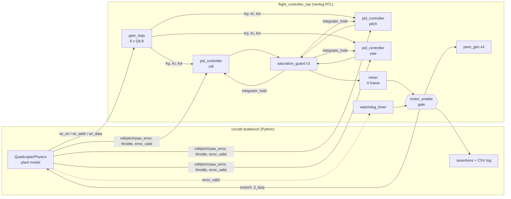

# Fixed-Point Quadcopter Flight Controller Core with HiL Co-Simulation

A parameterized quadcopter attitude-controller core written in **Verilog** using signed **Q8.8 fixed-point** arithmetic, verified in closed loop against a **Python physics model** through a **cocotb** co-simulation testbench.

**Stack:** Verilog-2012 · Icarus Verilog · Python 3 · cocotb · NumPy / Matplotlib

> **Scope.** This project implements the *controller*: error in, motor commands out. It does not include an IMU driver or sensor-fusion filter; in simulation, a Python plant model supplies the angles and the testbench turns them into errors.
>
> **Terminology.** "HiL" is used in the common sense of closed-loop co-simulation: the RTL runs in a simulator and exchanges signals with a Python plant every clock. It is not a design running on physical hardware.

---

## Contents

1. [Highlights](#highlights)
2. [Architecture](#architecture)
3. [Repository layout](#repository-layout)
4. [Number format: Q8.8](#number-format-q88)
5. [Module reference](#module-reference)
6. [Verification](#verification)
7. [Results](#results)
8. [Quick start](#quick-start)
9. [Timing model and assumptions](#timing-model-and-assumptions)
10. [Known limitations](#known-limitations)
11. [Future work](#future-work)

---

## Highlights

- **Three PID loops** (roll, pitch, yaw) with a **filtered derivative** (exponential moving average), output clamping and an integrator-hold input.
- **Signed Q8.8 fixed-point datapath** with 32-bit intermediates, saturating arithmetic and per-stage overflow flags.
- **X-frame motor mixer** that decouples the three axes and clamps motors to the valid range.
- **Four PWM generators** driven from the mixer outputs.
- **Runtime-writable gain register file** on a parallel write bus, for live PID retuning without re-synthesis.
- **Watchdog timer** that disarms all four motors when the input-valid signal is lost.
- **cocotb closed-loop testbench** against a Python physics model, with assertions on overflow, duty-cycle bounds, settling and watchdog failsafe, plus a 24-column CSV log and a plotting script.
- **Standalone Verilog testbench** for the PID and saturation guard.
- **Parameterized**: output limits, derivative-filter coefficient, clock and PWM frequency, watchdog timeout and all nine initial gains are module parameters.

---

## Architecture



One simulator clock is one control-loop iteration. In each iteration the testbench reads the four motor duties from the RTL, advances the physics one step, and writes the new errors back.

### Signal path and latency

| Stage | Type | Latency |
|---|---|---|
| error input to registered PID output | flip-flop | 1 clock |
| PID output to guard to mixer to watchdog gate to `motorN_duty` | combinational | 0 clocks |
| `motorN_duty` to `pwm_outN` | registered comparator | 1 clock |

---

## Repository layout

```
.
├── rtl/
│   ├── flight_controller_top.v   Top level: instantiates and wires everything
│   ├── pid_controller.v          One PID channel (P, I, filtered D) in Q8.8
│   ├── saturation_guard.v        Output clamp + hold/overflow flags
│   ├── mixer.v                   X-frame mixer, clamps motors to [0, 100]
│   ├── pwm_gen.v                 Counter-based PWM generator
│   ├── gain_regs.v               Nine writable gain registers (parallel write bus)
│   └── watchdog_timer.v          Input-valid timeout, produces motor_enable
└── sim/
    ├── tb_flight_controller.py   cocotb HiL test + Python physics model + assertions
    ├── run_sim.py                Builds with Icarus and runs the cocotb test
    ├── tb_pid.v                  Standalone Verilog testbench (PID + guard)
    ├── plot_response.py          Plots the logged step response
    ├── Makefile                  Alternative cocotb entry point
    └── step_response.png         Example output of plot_response.py
```

---

## Number format: Q8.8

All signals are 16-bit two's-complement words read as **signed Q8.8**: 1 sign bit, 7 integer bits, 8 fractional bits.

$$x = \frac{r}{2^{8}}, \qquad -128 \le x \le 127.99609375, \qquad \Delta = 2^{-8} = 0.00390625$$

| Value | Hex | Used for |
|---|---|---|
| 1.0 | `0x0100` | unity, `1 - alpha` |
| 0.5 | `0x0080` | `D_ALPHA` |
| 1.5 | `0x0180` | default `Kp` |
| 10.0 | `0x0A00` | default `Kd` |
| 50.0 | `0x3200` | hover throttle |
| 100.0 | `0x6400` | motor maximum |
| +127.0 / -127.0 | `0x7F00` / `0x8100` | PID output limits |

**Multiplication.** A Q8.8 x Q8.8 product is a 32-bit Q16.16 value. The result is rescaled by taking bits `[23:8]`. The product is valid only if bits `[31:23]` are all equal; otherwise the result saturates to `0x7FFF` or `0x8000` and an overflow flag is raised.

$$r_c = \left\lfloor \frac{r_a\, r_b}{2^{8}} \right\rfloor$$

Rescaling is a floor (round toward minus infinity), so truncation has a small negative bias of about half an LSB.

**Saturation, not wrap-around.** Every multiply, difference and sum is performed in a wider word and clamped, so a large command cannot wrap into one of the opposite sign.

---

## Module reference

### `pid_controller.v`

Per-sample PID with a filtered derivative, in Q8.8. Gains are *inputs* so they can change at runtime.

$$p_n = K_p\, e_n \qquad I_{n+1} = I_n + K_i\, e_n \qquad d_n = \alpha\,(e_n - e_{n-1}) + (1-\alpha)\, d_{n-1} \qquad D_n = K_d\, d_n$$

$$u_{n+1} = \mathrm{clamp}\big(p_n + \mathrm{clamp}(I_n) + D_n,\ \text{MIN\_OUT},\ \text{MAX\_OUT}\big)$$

- `integrator` is **32 bits** wide; its clamped 16-bit view feeds the sum.
- The error difference is computed in 17 bits, then clamped, so subtraction cannot wrap.
- The derivative filter is an **exponential moving average**. With `D_ALPHA = 0.5` and a 2.5 ms sample period, the time constant is `Ts / ln 2` ≈ 3.6 ms.
- `integrator_hold` stops integration when high.
- `overflow` is a registered flag raised if any product, sum, difference or the output limit was exceeded.

| Parameter | Default | Meaning |
|---|---|---|
| `MAX_OUT` / `MIN_OUT` | `16'h7F00` / `16'h8100` | Output limits (+/-127.0) |
| `D_ALPHA` | `16'h0080` | Derivative filter coefficient (0.5) |

### `saturation_guard.v`

Combinational clamp of a PID output to `[MIN_OUT, MAX_OUT]` that also exports `integrator_hold` and `overflow`. One guard per axis; its `integrator_hold` is fed back to the matching PID. (See [Known limitations](#known-limitations).)

### `mixer.v`

Combines throttle `T` and the three PID outputs `R`, `P`, `Y` into four motor duties and clamps each to `[0, 100.0]`.

$$m_0 = T - R + P + Y \qquad m_1 = T + R - P + Y \qquad m_2 = T + R + P - Y \qquad m_3 = T - R - P - Y$$

Each of `R`, `P`, `Y` appears with two plus and two minus signs, so total thrust stays `4T` and the three axes are decoupled:

$$-m_0+m_1+m_2-m_3 = 4R \qquad +m_0-m_1+m_2-m_3 = 4P \qquad +m_0+m_1-m_2-m_3 = 4Y$$

### `gain_regs.v`

Nine 16-bit Q8.8 registers behind a write-only parallel bus. `wr_en` is a single-cycle strobe sampled on the rising clock edge; writes to addresses above `0x8` are ignored; reset has priority and reloads the `*_INIT` parameters.

| Signal | Width | Meaning |
|---|---|---|
| `wr_en` | 1 | Write strobe |
| `wr_addr` | 4 | Register address |
| `wr_data` | 16 | New Q8.8 value |

| Addr | Register | Default |
|---|---|---|
| `0x0` | ROLL_Kp | 1.5 (`0x0180`) |
| `0x1` | ROLL_Ki | 0.0 |
| `0x2` | ROLL_Kd | 10.0 (`0x0A00`) |
| `0x3` | PITCH_Kp | 1.5 |
| `0x4` | PITCH_Ki | 0.0 |
| `0x5` | PITCH_Kd | 10.0 |
| `0x6` | YAW_Kp | 1.5 |
| `0x7` | YAW_Ki | 0.0 |
| `0x8` | YAW_Kd | 10.0 |

### `watchdog_timer.v`

A counter that is cleared whenever `error_valid` is high and counts otherwise. When it reaches `TIMEOUT_CYCLES`, `motor_enable` drops and the top level forces all four motor duties to zero through a combinational gate.

$$t_{\text{timeout}} = \frac{N + 1}{f_{\text{clk}}}, \qquad N = \text{TIMEOUT\_CYCLES}$$

The default is 50,000,000 cycles (about 1 s at 50 MHz). The testbench overrides it to **500** so the failsafe is reachable in simulation (`-Pflight_controller_top.WATCHDOG_TIMEOUT=500`). The watchdog re-arms automatically when `error_valid` returns.

### `pwm_gen.v`

A free-running counter from 0 to `COUNTER_MAX - 1` (`COUNTER_MAX = CLK_FREQ / PWM_FREQ`, 1,000,000 by default); the output is high while the counter is below a threshold derived from the duty word. Parameters: `CLK_FREQ` (50 MHz), `PWM_FREQ` (50 Hz).

### `flight_controller_top.v`

Instantiates 1 `gain_regs`, 3 `pid_controller`, 3 `saturation_guard`, 1 `mixer`, 1 `watchdog_timer` and 4 `pwm_gen`, passes parameters down, and exposes the clamped PID outputs, motor duties, PWM pins and overflow flags for monitoring.

---

## Verification

### 1. Standalone testbench: `sim/tb_pid.v`

Drives one PID plus a saturation guard through six scenarios and prints a table: positive step, return to zero (integrator retention), negative step, saturating step, gain change, and reset. It also writes `tb_pid.vcd` for waveform viewing. It is a stimulus-and-observe testbench with printed PASS/FAIL messages for the reset check.

### 2. Closed-loop co-simulation: `sim/tb_flight_controller.py`

A cocotb test that runs **3500 clock cycles**, each representing one 2.5 ms control step (8.75 s of flight):

| Cycle | Event |
|---|---|
| 0 | Reset released; step setpoints applied (roll 10 deg, pitch 5 deg, yaw 0 deg), hover throttle 50.0 |
| 1500 | **Runtime retune**: roll and pitch `Kp` written 1.5 to 1.8 over the gain bus |
| 2500 | **Sensor failure**: `error_valid` forced low |
| about 3000 | Watchdog times out; all motor duties go to 0 |

Each cycle the testbench reads `motor0..3_duty`, steps the plant, computes `error = setpoint - angle`, converts to Q8.8 and drives it back into the DUT.

**Assertions**

| Check | Condition |
|---|---|
| Arithmetic overflow | `roll/pitch/yaw_pid_overflow == 0` every cycle |
| Duty-cycle bounds | `0.0 <= motorN_duty <= 127.0` every cycle |
| Divergence | fewer than 500 consecutive cycles with any motor at its limits |
| Settling | at cycles 1499 and 2499: all three axis errors < 1.0 deg; roll and pitch < 0.5 deg |
| Watchdog failsafe | after cycle 3050 all four motor duties are exactly 0.0 |

### Physics model: `QuadcopterPhysics`

A rigid-body attitude model with a simple translational part, integrated with semi-implicit Euler at `dt = 2.5 ms`.

$$F_i = k_T\, d_i \qquad \tau_{\text{roll}} = \tfrac{L}{\sqrt{2}}(-F_0+F_1+F_2-F_3) \qquad \tau_{\text{pitch}} = \tfrac{L}{\sqrt{2}}(F_0-F_1+F_2-F_3) \qquad \tau_{\text{yaw}} = c_Q(F_0+F_1-F_2-F_3)$$

$$\alpha = \frac{\tau - c\,\omega}{I}, \qquad \omega_{n+1} = \omega_n + \alpha\, dt, \qquad \theta_{n+1} = \theta_n + \omega_{n+1}\, dt$$

| Parameter | Value |
|---|---|
| Roll / pitch inertia | 0.01 kg m^2 |
| Yaw inertia | 0.02 kg m^2 |
| Arm length `L` | 0.225 m |
| Thrust coefficient `k_T` | 0.02 N per duty unit |
| Yaw coefficient `c_Q` | 0.005 |
| Roll / pitch damping | 0.15 N m s/rad |
| Mass | 4 / 9.81 kg (hover duty 50.0 balances weight) |

With the mixer above, a roll command `R` produces an angular acceleration of about 72.9 deg/s^2 per unit, and the roll plant is `θ'' + 15 θ' = 72.9 R`.

---

## Results

Measured from the CSV log of a full run (Icarus Verilog 12, cocotb 2.1.0):

| Metric | Roll (10 deg step) | Pitch (5 deg step) |
|---|---|---|
| Peak overshoot | 0.128 deg (1.3 %) | 0.055 deg (1.1 %) |
| Settled within 1.0 deg | 272.5 ms | 227.5 ms |
| Settled within 0.1 deg | 557.5 ms | 355 ms |
| **Settled within 0.01 deg** | **742.5 ms** | **692.5 ms** |
| Final error | 0.006 deg | 0.003 deg |

| Event | Observed |
|---|---|
| First correction (cycle 2) | roll PID 65.0, pitch PID 32.5; motors `[17.5, 82.5, 100.0, 0.0]` |
| Watchdog failsafe | all four motors exactly 0.0 from cycle 3002 |
| Yaw | 0.000 deg throughout (setpoint 0, no disturbance) |

**Sanity check against theory.** With `Kp = 1.5` and an effective derivative gain `Kd x Ts = 0.025 s`, the closed-loop roll dynamics are second order with natural frequency about 10.5 rad/s and damping ratio about 0.80, which predicts about 1.4 % overshoot, close to the 1.3 % measured.

**Note on 0.01 deg.** This is a measured result, not an assertion. It corresponds to about 2.5 LSB of the Q8.8 error input (0.01 x 256), so it is as much a statement about fixed-point resolution as controller quality. A residual of about 0.006 deg remains because of Q8.8 quantization.


---

## Quick start

### Prerequisites

- [Icarus Verilog](https://steveicarus.github.io/iverilog/) 12 or newer (`iverilog`, `vvp`)
- Python 3.9+

```bash
# Ubuntu / Debian / WSL
sudo apt-get install -y iverilog
pip install cocotb matplotlib numpy
```

Tested with Icarus Verilog 12.0 and cocotb 2.1.0. The testbench uses the cocotb 2.x API (`unit="ns"`, `cocotb_tools.runner`), so cocotb 1.x will not work.

### Run the standalone testbench

```bash
iverilog -o sim/tb_pid.vvp rtl/pid_controller.v rtl/saturation_guard.v sim/tb_pid.v
vvp sim/tb_pid.vvp
```

### Run the full closed-loop co-simulation

```bash
python sim/run_sim.py
```

This compiles all seven RTL files with `-g2012`, overrides the watchdog timeout to 500 cycles, runs the cocotb test, and writes the log to `sim/sim_build/hil_flight_log.csv`. Expected end of output:

```
Final angles - Roll: 9.994, Pitch: 4.997, Yaw: -0.000
Final errors - Roll: 0.006, Pitch: 0.003
TESTS=1 PASS=1 FAIL=0 SKIP=0
```

### Plot the response

```bash
python sim/plot_response.py --csv sim/sim_build/hil_flight_log.csv --output step_response.png
```

### Change something

- **Tune gains:** edit the `*_INIT` parameters in `rtl/gain_regs.v`, or write them at runtime through the gain bus (see the retune in `tb_flight_controller.py`).
- **Change the scenario:** edit the setpoints, throttle, event cycles and `NUM_CYCLES` at the top of the test in `tb_flight_controller.py`.
- **Change the plant:** edit the constants in `QuadcopterPhysics`.

---

## Timing model and assumptions

- The testbench clock has a 20 ns period (50 MHz), and **one clock cycle represents one 2.5 ms control step (400 Hz)**. The two are independent: it is a modelling choice.
- The PID performs a full computation on **every** clock and has no sample-tick enable. On real hardware you would add a 400 Hz enable so that the integrator and derivative update once per control period. Because the derivative gain multiplies a per-sample difference, its effective strength depends on this rate.
- The watchdog's 500-cycle test timeout equals 1.25 s of simulated flight time; the 50,000,000-cycle default is 1 s at a true 50 MHz.

---

## Known limitations

These are documented deliberately so that the results above are read correctly.

- **Integrator hold does not currently assert.** `pid_controller` already clamps its output to `[MIN_OUT, MAX_OUT]`, and `saturation_guard` flags saturation only for values strictly beyond those limits, so `integrator_hold` stays low. The integrator therefore keeps accumulating under sustained saturation. This does not affect the default flight demo (default `Ki = 0`, and PID output peaks at about 65 against a limit of 127). Changing the guard comparisons to `>=` / `<=` is the intended fix.
- **PWM duty scaling.** `pwm_gen` interprets its duty word as a fraction of 1.0, while the mixer produces values on a 0-100 scale, so the generated high-time does not match the duty value (at 50 MHz / 50 Hz, a duty of 50.0 gives about 71.7 %). The closed-loop test reads the duty numbers, not the `pwm_out` pins, so this is not exercised. Scaling by `COUNTER_MAX / 100` is the intended fix.
- **Test coverage gaps.** The PWM pins are not checked; the retune at cycle 1500 happens after the loop has settled, so no assertion shows its effect; the duty bound is 0-127 whereas the mixer clamps at 100; the 0.01 deg figure is measured, not asserted.
- **`tb_pid.v` is not self-failing.** It prints PASS/FAIL text but does not set a non-zero exit status on failure, and `run_sim.py` does not propagate cocotb failures to its exit code. Do not rely on the exit status of either to detect failures.
- **`sim/Makefile`** does not list `rtl/watchdog_timer.v`; use `python sim/run_sim.py`, or add that file to `VERILOG_SOURCES`.
- **Derivative on error.** A setpoint step produces a derivative kick (first-sample D term of 50 versus 15 from P at the initial step).
- **Simplified plant.** Altitude is not exercised (hover thrust equals weight and the vehicle starts on a ground plane), and the physics model has no sensor noise or motor dynamics.
- **Watchdog behaviour.** It supervises only the `error_valid` flag (not data quality) and re-arms automatically rather than latching.

## Future work

- Add a sample-tick enable for a true fixed control rate.
- Back-calculation anti-windup and derivative-on-measurement.
- Mixer desaturation to preserve roll/pitch authority at the motor limits.
- Double-buffered PWM mapped to the 1-2 ms ESC pulse protocol, with a test that measures the `pwm_out` pins.
- Read-back path and atomic multi-gain update for the register file; latched failsafe with explicit re-arm.
- Tests that verify the retune effect and a bit-accurate Python reference model for random-stimulus regression.
- Synthesize for an FPGA and report resource use and maximum clock frequency.

---

## License

Add a license of your choice (for example MIT) as a `LICENSE` file.
