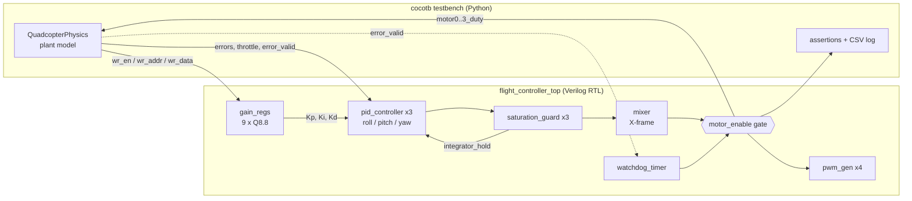

<div align="center">

# Fixed-Point Quadcopter Flight Controller Core

**A parameterized Verilog attitude controller (signed Q8.8) verified in closed loop against a Python physics model with cocotb.**


</div>

> **Overview.** The core takes attitude errors in and produces motor commands out. It is verified by testbench: a cocotb test closes the loop between the RTL and a Python quadcopter plant model, exchanging signals every clock cycle, and a standalone Verilog testbench exercises the PID and saturation guard.

## Contents

- [Features](#features)
- [Results at a glance](#results-at-a-glance)
- [Quick start](#quick-start)
- [Architecture](#architecture)
- [Repository layout](#repository-layout)
- [Number format: Q8.8](#number-format-q88)
- [Module reference](#module-reference)
- [Verification](#verification)
- [Detailed results](#detailed-results)
- [Timing model and assumptions](#timing-model-and-assumptions)
- [Known limitations](#known-limitations)
- [Future work](#future-work)

## Features

- **Three PID loops** (roll, pitch, yaw) with a **filtered derivative** (exponential moving average), output clamping and an integrator-hold input
- **Signed Q8.8 datapath** with 32-bit intermediates, saturating arithmetic and per-stage overflow flags
- **X-frame motor mixer** that decouples the three axes and clamps motors to the valid range
- **Four PWM generators** driven from the mixer outputs
- **Runtime-writable gain register file** on a parallel write bus for live PID retuning, with no re-synthesis
- **Watchdog timer** that disarms all four motors when the input-valid signal is lost
- **cocotb closed-loop testbench** with assertions on overflow, duty-cycle bounds, settling and watchdog failsafe, plus a CSV log and a plotting script
- **Standalone Verilog testbench** for the PID and saturation guard
- **Parameterized**: output limits, derivative-filter coefficient, clock and PWM frequency, watchdog timeout and all nine initial gains

## Results at a glance

| Metric (full run, Icarus Verilog 12 + cocotb 2.1.0) | Roll (10° step) | Pitch (5° step) |
|---|---|---|
| Peak overshoot | 0.128° (1.3 %) | 0.055° (1.1 %) |
| Within 0.1° of setpoint | 557.5 ms | 355 ms |
| **Within 0.01° of setpoint** | **742.5 ms** | **692.5 ms** |
| Final error | 0.006° | 0.003° |

Watchdog failsafe: after the simulated sensor failure, all four motor duties are exactly `0.0` from cycle 3002.

## Quick start

**Prerequisites:** [Icarus Verilog](https://steveicarus.github.io/iverilog/) 12+ and Python 3.9+.

```bash
# Ubuntu / Debian / WSL
sudo apt-get install -y iverilog
pip install cocotb matplotlib numpy
```

Tested with Icarus Verilog 12.0 and cocotb 2.1.0. The testbench uses the cocotb 2.x API, so cocotb 1.x will not work.

**1. Standalone PID testbench**

```bash
iverilog -o sim/tb_pid.vvp rtl/pid_controller.v rtl/saturation_guard.v sim/tb_pid.v
vvp sim/tb_pid.vvp
```

**2. Full closed-loop co-simulation**

```bash
python sim/run_sim.py
```

This compiles the seven RTL files with `-g2012`, overrides the watchdog timeout to 500 cycles, runs the cocotb test, and writes the log to `sim/sim_build/hil_flight_log.csv`. Expected end of output:

```text
Final angles - Roll: 9.994, Pitch: 4.997, Yaw: -0.000
Final errors - Roll: 0.006, Pitch: 0.003
TESTS=1 PASS=1 FAIL=0 SKIP=0
```

**3. Plot the response**

```bash
python sim/plot_response.py --csv sim/sim_build/hil_flight_log.csv --output step_response.png
```

**Customising**

- *Gains:* edit the `*_INIT` parameters in `rtl/gain_regs.v`, or write them at runtime over the gain bus (see the retune in `tb_flight_controller.py`).
- *Scenario:* edit setpoints, throttle, event cycles and `NUM_CYCLES` in `sim/tb_flight_controller.py`.
- *Plant:* edit the constants in the `QuadcopterPhysics` class.

## Architecture



One simulator clock is one control-loop iteration. Each iteration the testbench reads the four motor duties, advances the physics one step, and writes the new errors back.

| Stage | Type | Latency |
|---|---|---|
| error input to registered PID output | flip-flop | 1 clock |
| PID output, guard, mixer, watchdog gate to `motorN_duty` | combinational | 0 clocks |
| `motorN_duty` to `pwm_outN` | registered comparator | 1 clock |

## Repository layout

```text
.
├── rtl/
│   ├── flight_controller_top.v   Top level: instantiates and wires everything
│   ├── pid_controller.v          One PID channel (P, I, filtered D) in Q8.8
│   ├── saturation_guard.v        Output clamp with hold / overflow flags
│   ├── mixer.v                   X-frame mixer, clamps motors to [0, 100]
│   ├── pwm_gen.v                 Counter-based PWM generator
│   ├── gain_regs.v               Nine writable gain registers (parallel write bus)
│   └── watchdog_timer.v          Input-valid timeout, produces motor_enable
└── sim/
    ├── tb_flight_controller.py   cocotb test + Python physics model + assertions
    ├── run_sim.py                Builds with Icarus and runs the cocotb test
    ├── tb_pid.v                  Standalone Verilog testbench (PID + guard)
    ├── plot_response.py          Plots the logged step response
    └── Makefile                  Alternative cocotb entry point
```

## Number format: Q8.8

Every signal is a 16-bit two's-complement word read as **signed Q8.8**: 1 sign bit, 7 integer bits, 8 fractional bits.

$$x = \frac{r}{2^{8}}, \qquad -128 \le x \le 127.99609375, \qquad \Delta = 2^{-8} = 0.00390625$$

| Value | Hex | Used for |
|---|---|---|
| 1.0 | `0x0100` | unity, `1 - alpha` |
| 0.5 | `0x0080` | `D_ALPHA` |
| 1.5 | `0x0180` | default `Kp` |
| 10.0 | `0x0A00` | default `Kd` |
| 50.0 | `0x3200` | hover throttle |
| 100.0 | `0x6400` | motor maximum |
| ±127.0 | `0x7F00` / `0x8100` | PID output limits |

**Multiplication.** A Q8.8 × Q8.8 product is a 32-bit Q16.16 value. It is rescaled by taking bits `[23:8]`, and it is valid only if bits `[31:23]` are all equal. Otherwise the result saturates to `0x7FFF` or `0x8000` and an overflow flag is raised.

$$r_c = \left\lfloor \frac{r_a\, r_b}{2^{8}} \right\rfloor$$

Rescaling is a floor, so truncation carries a small negative bias of about half an LSB. Every multiply, difference and sum is done in a wider word and clamped, so a large command cannot wrap into one of opposite sign.

## Module reference

<details>
<summary><b>pid_controller.v</b> — PID with filtered derivative</summary>

<br>

Per-sample PID in Q8.8. Gains are *inputs*, so they can change at runtime.

$$p_n = K_p\, e_n \qquad I_{n+1} = I_n + K_i\, e_n \qquad d_n = \alpha\,(e_n - e_{n-1}) + (1-\alpha)\, d_{n-1} \qquad D_n = K_d\, d_n$$

$$u_{n+1} = \mathrm{clamp}\big(p_n + \mathrm{clamp}(I_n) + D_n,\ \mathrm{MIN},\ \mathrm{MAX}\big)$$

- The integrator is **32 bits** wide; its clamped 16-bit view feeds the sum.
- The error difference is computed in 17 bits and then clamped, so the subtraction cannot wrap.
- The derivative filter is an exponential moving average. With `D_ALPHA = 0.5` and a 2.5 ms sample period its time constant is about 3.6 ms.
- `integrator_hold` stops integration when high.
- `overflow` is a registered flag raised if any product, sum or difference overflowed or the output limit was exceeded.

| Parameter | Default | Meaning |
|---|---|---|
| `MAX_OUT` / `MIN_OUT` | `16'h7F00` / `16'h8100` | Output limits (±127.0) |
| `D_ALPHA` | `16'h0080` | Derivative filter coefficient (0.5) |

</details>

<details>
<summary><b>saturation_guard.v</b> — output clamp and flags</summary>

<br>

Combinational clamp of a PID output to `[MIN_OUT, MAX_OUT]` that also exports `integrator_hold` and `overflow`. There is one guard per axis, and its `integrator_hold` is fed back to the matching PID. See [Known limitations](#known-limitations).

</details>

<details>
<summary><b>mixer.v</b> — X-frame motor mixing</summary>

<br>

Combines throttle `T` and the three PID outputs `R`, `P`, `Y` into four motor duties, each clamped to `[0, 100.0]`.

$$m_0 = T - R + P + Y \qquad m_1 = T + R - P + Y \qquad m_2 = T + R + P - Y \qquad m_3 = T - R - P - Y$$

Each of `R`, `P`, `Y` appears with two plus and two minus signs, so total thrust stays `4T` and the axes are decoupled:

$$-m_0+m_1+m_2-m_3 = 4R \qquad +m_0-m_1+m_2-m_3 = 4P \qquad +m_0+m_1-m_2-m_3 = 4Y$$

</details>

<details>
<summary><b>gain_regs.v</b> — runtime gain register file</summary>

<br>

Nine 16-bit Q8.8 registers behind a write-only parallel bus. `wr_en` is a single-cycle strobe sampled on the rising clock edge. Writes to addresses above `0x8` are ignored. Reset has priority and reloads the `*_INIT` parameters.

| Signal | Width | Meaning |
|---|---|---|
| `wr_en` | 1 | Write strobe |
| `wr_addr` | 4 | Register address |
| `wr_data` | 16 | New Q8.8 value |

| Address | Register | Default |
|---|---|---|
| `0x0` / `0x1` / `0x2` | ROLL `Kp` / `Ki` / `Kd` | 1.5 / 0.0 / 10.0 |
| `0x3` / `0x4` / `0x5` | PITCH `Kp` / `Ki` / `Kd` | 1.5 / 0.0 / 10.0 |
| `0x6` / `0x7` / `0x8` | YAW `Kp` / `Ki` / `Kd` | 1.5 / 0.0 / 10.0 |

</details>

<details>
<summary><b>watchdog_timer.v</b> — input-valid failsafe</summary>

<br>

A counter is cleared whenever `error_valid` is high and counts otherwise. When it reaches `TIMEOUT_CYCLES`, `motor_enable` drops and the top level forces all four motor duties to zero through a combinational gate.

$$t_{\text{timeout}} = \frac{N + 1}{f_{\text{clk}}}, \qquad N = \mathrm{TIMEOUT\_CYCLES}$$

The default is 50,000,000 cycles (about 1 s at 50 MHz). The testbench overrides it to **500** with `-Pflight_controller_top.WATCHDOG_TIMEOUT=500` so the failsafe is reachable in simulation. The watchdog re-arms automatically when `error_valid` returns.

</details>

<details>
<summary><b>pwm_gen.v</b> — PWM generator</summary>

<br>

A free-running counter from 0 to `COUNTER_MAX - 1` (`COUNTER_MAX = CLK_FREQ / PWM_FREQ`, 1,000,000 by default). The output is high while the counter is below a threshold derived from the duty word. Parameters: `CLK_FREQ` (50 MHz) and `PWM_FREQ` (50 Hz).

</details>

<details>
<summary><b>flight_controller_top.v</b> — integration</summary>

<br>

Instantiates 1 `gain_regs`, 3 `pid_controller`, 3 `saturation_guard`, 1 `mixer`, 1 `watchdog_timer` and 4 `pwm_gen`. It passes parameters down and exposes the clamped PID outputs, motor duties, PWM pins and overflow flags for monitoring.

</details>

## Verification

### Standalone testbench: `sim/tb_pid.v`

Drives one PID and one saturation guard through six scenarios and prints a table: positive step, return to zero (integrator retention), negative step, saturating step, gain change, and reset. It also writes `tb_pid.vcd` for waveform viewing. The reset check prints a PASS/FAIL message.

### Closed-loop co-simulation: `sim/tb_flight_controller.py`

A cocotb test of **3500 clock cycles**, each representing one 2.5 ms control step (8.75 s of flight):

| Cycle | Event |
|---|---|
| 0 | Reset released; step setpoints applied (roll 10°, pitch 5°, yaw 0°); hover throttle 50.0 |
| 1500 | **Runtime retune:** roll and pitch `Kp` written from 1.5 to 1.8 over the gain bus |
| 2500 | **Sensor failure:** `error_valid` forced low |
| ≈ 3000 | Watchdog times out; all motor duties go to 0 |

Each cycle the testbench reads `motor0..3_duty`, steps the plant, computes `error = setpoint − angle`, converts it to Q8.8 and drives it back into the DUT.

| Assertion | Condition |
|---|---|
| Arithmetic overflow | `roll/pitch/yaw_pid_overflow == 0` every cycle |
| Duty-cycle bounds | `0.0 ≤ motorN_duty ≤ 127.0` every cycle |
| Divergence | fewer than 500 consecutive cycles with any motor at its limits |
| Settling | at cycles 1499 and 2499: all axis errors < 1.0°; roll and pitch < 0.5° |
| Watchdog failsafe | after cycle 3050 all four motor duties are exactly 0.0 |

### Physics model: `QuadcopterPhysics`

A rigid-body attitude model with a simple translational part, integrated with semi-implicit Euler at `dt = 2.5 ms`.

$$F_i = k_T\, d_i \qquad \tau_{\text{roll}} = \tfrac{L}{\sqrt{2}}(-F_0+F_1+F_2-F_3) \qquad \tau_{\text{pitch}} = \tfrac{L}{\sqrt{2}}(F_0-F_1+F_2-F_3) \qquad \tau_{\text{yaw}} = c_Q(F_0+F_1-F_2-F_3)$$

$$\alpha = \frac{\tau - c\,\omega}{I}, \qquad \omega_{n+1} = \omega_n + \alpha\, dt, \qquad \theta_{n+1} = \theta_n + \omega_{n+1}\, dt$$

| Parameter | Value |
|---|---|
| Roll / pitch inertia | 0.01 kg·m² |
| Yaw inertia | 0.02 kg·m² |
| Arm length `L` | 0.225 m |
| Thrust coefficient `k_T` | 0.02 N per duty unit |
| Yaw coefficient `c_Q` | 0.005 |
| Roll / pitch damping | 0.15 N·m·s/rad |
| Mass | 4 / 9.81 kg (hover duty 50.0 balances weight) |

## Detailed results

| Metric | Roll (10° step) | Pitch (5° step) |
|---|---|---|
| Peak overshoot | 0.128° | 0.055° |
| Within 1.0° | 272.5 ms | 227.5 ms |
| Within 0.5° | 310 ms | 277.5 ms |
| Within 0.1° | 557.5 ms | 355 ms |
| Within 0.05° | 642.5 ms | 527.5 ms |
| Within 0.01° | 742.5 ms | 692.5 ms |
| Final error | 0.006° | 0.003° |

| Event | Observed |
|---|---|
| First correction (cycle 2) | roll PID 65.0, pitch PID 32.5; motors `[17.5, 82.5, 100.0, 0.0]` |
| Watchdog failsafe | all four motors exactly 0.0 from cycle 3002 |
| Yaw | 0.000° throughout (setpoint 0, no disturbance) |

**Check against theory.** With `Kp = 1.5` and an effective derivative gain `Kd·Ts = 0.025 s`, the closed-loop roll dynamics are second order with natural frequency ≈ 10.5 rad/s and damping ratio ≈ 0.80. That predicts about 1.4 % overshoot, close to the 1.3 % measured.

**About the 0.01° figure.** It is a measured result, not an assertion. It equals about 2.5 LSB of the Q8.8 error input (0.01 × 256), so it reflects fixed-point resolution as much as controller quality. A residual of about 0.006° remains, consistent with Q8.8 quantization.

## Timing model and assumptions

- The testbench clock has a 20 ns period (50 MHz), and **one clock cycle represents one 2.5 ms control step (400 Hz)**. The two are independent: this is a modelling choice.
- The PID performs a full computation on **every** clock and has no sample-tick enable. A 400 Hz sample-tick enable would make the integrator and derivative update once per control period, because the derivative gain multiplies a per-sample difference.
- The watchdog's 500-cycle test timeout equals 1.25 s of simulated flight time; the 50,000,000-cycle default is 1 s at a true 50 MHz.

## Known limitations

- **Integrator hold does not currently assert.** `pid_controller` already clamps its output to `[MIN_OUT, MAX_OUT]`, and `saturation_guard` flags saturation only for values strictly beyond those limits, so `integrator_hold` stays low and the integrator keeps accumulating under sustained saturation. The default flight demo is unaffected (default `Ki = 0`, and the PID output peaks near 65 against a limit of 127). Changing the guard comparisons to `>=` / `<=` is the intended fix.
- **PWM duty scaling.** `pwm_gen` treats its duty word as a fraction of 1.0, while the mixer produces values on a 0–100 scale, so the generated high-time does not match the duty value (at 50 MHz / 50 Hz a duty of 50.0 gives about 71.7 %). The closed-loop test reads duty numbers, not the `pwm_out` pins, so this is not exercised. Scaling by `COUNTER_MAX / 100` is the intended fix.
- **Test coverage gaps.** PWM pins are not checked; the retune at cycle 1500 happens after the loop has settled, so no assertion shows its effect; the duty bound is 0–127 while the mixer clamps at 100; the 0.01° figure is measured, not asserted.
- **Exit codes.** `tb_pid.v` prints PASS/FAIL text but does not set a non-zero exit status, and `run_sim.py` does not propagate cocotb failures to its exit code. Do not rely on either to detect failures in automation.
- **`sim/Makefile`** does not list `rtl/watchdog_timer.v`. Use `python sim/run_sim.py`, or add that file to `VERILOG_SOURCES`.
- **Derivative on error.** A setpoint step produces a derivative kick (first-sample D term of 50 versus 15 from P).
- **Plant model.** Altitude is not exercised (hover thrust equals weight), and the model has no sensor noise or motor dynamics.
- **Watchdog.** It supervises only the `error_valid` flag, not data quality, and re-arms automatically rather than latching.

## Future work

- [ ] Sample-tick enable for a true fixed control rate
- [ ] Back-calculation anti-windup and derivative-on-measurement
- [ ] Mixer desaturation to preserve roll/pitch authority at the motor limits
- [ ] Double-buffered PWM mapped to the 1–2 ms ESC pulse protocol, with a test that measures the `pwm_out` pins
- [ ] Read-back path and atomic multi-gain update for the register file; latched failsafe with explicit re-arm
- [ ] Tests that verify the retune effect, and a bit-accurate Python reference model for random-stimulus regression
- [ ] FPGA synthesis with resource and maximum-frequency report

## License

Add a license of your choice (for example MIT) as a `LICENSE` file in the repository root.